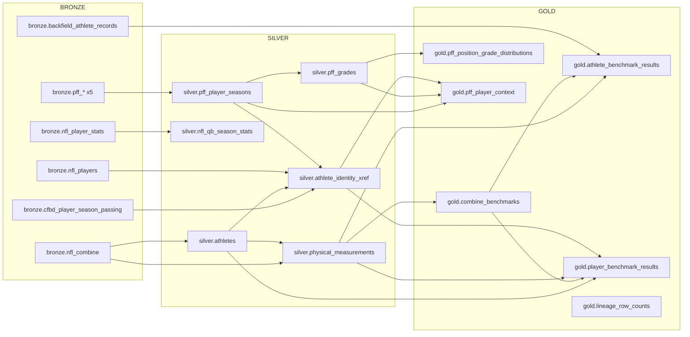

# Backfield AI Scouting Combine — Best Use of Bruin

**Repo:** https://github.com/omarubilla/backfield-bruin · **Live API (HTTPS):** https://omar-ubilla--backfield-bruin-api.us-east.modal.run
**Showcase JSON for judges / LingCode:** [`/v1/public/showcase`](https://omar-ubilla--backfield-bruin-api.us-east.modal.run/v1/public/showcase)

Every number below comes from the runs recorded in [`docs/evidence/`](docs/evidence) (Bruin v0.11.832). Latest run: 2026-11-24 00:14:41Z → 00:15:00Z UTC.

---

## 1. The problem Bruin solves for Backfield
Backfield's three AI coaches (QB Coach, Film Analyst, Scout) must judge athletes against **real, defensible evidence**. That
evidence lives in incompatible places: NFL Combine results (nflverse), licensed PFF college/pro grades, and Backfield's own
athlete captures (e.g. the AR 10-yard dash). They use different player ids, units, positions and licences, have gaps, and
some measurements (a 10-yard split) simply don't exist in the reference data. Without a pipeline, an LLM would happily
average a hand-timed 40 with an electronic one, merge two players who share a name, or invent a percentile.

## 2. Why Bruin is essential, not decorative
Bruin **is** the evidence layer the agents read. Remove it and the API has nothing to serve:
- **One reproducible DAG** (32 assets, Python + SQL) ingests every source, normalizes it, and produces the gold tables the API serves.
- **103 quality checks run inside every build** (built-in `not_null`, `unique`, `accepted_values`, `min`/`max`, plus custom SQL), e.g.
  *percentile present exactly when calculable*, *no gsis id linked to two PFF players*, *every real player linked by provider id*,
  *percentiles ordered*, *completions ≤ attempts*. A blocking failure stops downstream assets; the API exposes `pipeline.validated`.
- **Lineage and licensing travel with the data**: every row carries provider, source record id, capture method, licence category;
  PFF values are labelled `gradeSource: "PFF"` and redacted in public responses.
- **Identity reconciliation** happens in Bruin SQL using provider ids only (section 8).

## 3. Architecture and data sources
```
nflverse (combine, players, weekly stats) ┐
PFF Developer API (PFF Pro key)            ├─► Bruin bronze ─► silver ─► gold (DuckDB) ─► serving snapshot ─► Modal FastAPI (HTTPS)
Backfield athlete evidence (synthetic demo)│                                                   ├─ /v1/public/*  (no auth, PFF redacted)
CollegeFootballData (provider wired, no key)┘                                                  └─ /v1/private/* (Bearer, full PFF)
                                                                                                        │
                                                       Gemini/BAND three-agent coaching room ◄──────────┤  LingCode scouting UI
```
| Source | Status | Rows in bronze (this run) | Licence handling |
|---|---|---|---|
| nflverse combine | available | 8,968 (2000–2026) | public open data, attributed |
| nflverse players | available | 24,871 (11,651 carry a `pff_id`) | public |
| nflverse weekly stats | available | 110,390 (2019–2024) | public |
| PFF passing / rushing / receiving / offense season reports | available (PFF Pro, entitled) | 2,651 / 8,209 / 11,568 / 29,572 = **52,000** (NFL+NCAA, 2024–2025) | internal only; never committed or exported raw |
| PFF NCAA rosters (6 FBS teams) | available | 615 | internal only |
| Backfield athlete records | synthetic demo | 7 | labelled `isSynthetic` |
| CollegeFootballData | provider implemented, key not configured | 0 (status row) | — |

## 4. Pipeline and dependency graph
32 assets · bronze 12 · silver 7 · gold 13. Full machine-readable graph: [`docs/evidence/lineage.json`](docs/evidence/lineage.json),
Mermaid: [`docs/evidence/lineage.mmd`](docs/evidence/lineage.mmd), Bruin's own lineage dump:
[`docs/evidence/bruin_lineage_player_benchmark_results.txt`](docs/evidence/bruin_lineage_player_benchmark_results.txt).



| Stage | What Bruin does |
|---|---|
| Bronze | Python assets pull each provider into its own table with `_source_provider`, `_endpoint`, `_license_category`, `_ingested_at` (ingestr stamps `_ingestr_loaded_at`). Missing keys write a status row instead of failing. |
| Silver | `silver.athletes` (identity keyed on pfr/cfb ids, provisional keys otherwise, never merged by name); `silver.physical_measurements` (8 metrics in long form with unit, definition, plausibility flag, source record id); `silver.pff_player_seasons` (4 PFF reports joined per player-league-season, prefixed columns); `silver.pff_grades` (99,003 long-form grades with qualifying volume); `silver.athlete_identity_xref`. |
| Gold | Position combine distributions; the evaluation contract tables for the demo athlete and for 1,288 real linked players; PFF within-position distributions and player context; lineage row counts. |

## 5. Reproduce it
```bash
git clone https://github.com/omarubilla/backfield-bruin && cd backfield-bruin
curl -LsSf https://getbruin.com/install/cli | sh                 # Bruin CLI
echo "PFF_API_KEY=<your PFF Pro key>" >> .env                    # optional; .env is git-ignored
scripts/run_pipeline.sh                                          # bruin run pipeline + logs/bruin_run_latest.{log,json}
uv run --python 3.12 --with duckdb python scripts/capture_evidence.py      # docs/evidence/*
uv run --python 3.12 --with duckdb --with pytest --with jsonschema --with rfc3339-validator \
       --with fastapi --with httpx --with google-auth --with requests python -m pytest tests   # 27 tests
uv run --python 3.12 --with duckdb python scripts/build_serving_db.py      # gold-only snapshot
modal deploy deploy/modal_app.py                                 # HTTPS API (needs Modal secret backfield-bruin-api)
```
Without a PFF key the PFF assets write status rows and the rest of the pipeline still runs.

## 6. Real execution results (this run)
- Latest `bruin run` (after syncing live assessments): **18.8s** — 32/32 assets executed (31 clean, 1 with the non-blocking check failure below), **102/103 checks passed**, 0 blocking failures → `validated: true`. The earlier full run before the live-assessment assets took 1m29.89s for 27 assets (84/85 checks).
  Raw log: [`docs/evidence/bruin_run.log`](docs/evidence/bruin_run.log); parsed status: [`docs/evidence/bruin_run_status.json`](docs/evidence/bruin_run_status.json).
- Row counts per stage (computed by Bruin in `gold.lineage_row_counts`): [`docs/evidence/row_counts.md`](docs/evidence/row_counts.md). Highlights:
  54,968 normalized combine measurements · 29,572 PFF player-seasons · 99,003 PFF grade rows · 88 combine distributions · 10,128 real-player benchmark rows.
- QB combine benchmark (`gold.combine_benchmarks`, [`qb_combine_benchmarks.md`](docs/evidence/qb_combine_benchmarks.md)): e.g. 40-yard dash n=413, p10 4.59 s, p50 4.81 s, p90 5.04 s, seasons 2000–2026. No 10-yard split exists in the source; none is fabricated.
- **Provenance** ([`provenance.md`](docs/evidence/provenance.md)): bronze rows carry `_ingestr_loaded_at` timestamps inside the run window; silver/gold are Bruin-materialized SQL tables; the API reads those tables (gold-only snapshot), not precomputed JSON.

## 7. Tests and data quality
- **103 Bruin checks** in the DAG (see 2). **27 pytest tests**: schema 1.1.0 validation, percentile-only-when-calculable, no fabricated 10-yard cohort,
  explicit missing metrics, direction-aware percentiles, PFF labelled and never mixed into combine measurements, provider-id player linking,
  real-player redaction, public responses free of PFF values, private routes require a token, showcase reports the exception; live assessments: contract validation, 10-yard results never get a percentile, Python and Bruin SQL comparisons agree, writes need auth, public views redact identity, AR-dash adapter, motion estimates labelled.
- **Open data-quality exception (kept visible):** `bronze.nfl_player_stats: player_id.not_null` — **130** nflverse weekly-stat rows have no GSIS id.
  Non-blocking by design; rows stay in bronze for lineage and are excluded from `silver.nfl_qb_season_stats`; no impact on combine benchmarks,
  percentiles or PFF data. Reported in every payload (`pipeline.dataQualityExceptions`) and in `/v1/public/pipeline/status`.

## 8. Player identity reconciliation
PFF `player_id` = nflverse `players.pff_id` → `gsis_id` / `pfr_id` → combine athlete `pfr:<pfr_id>`. **No name matching** is used to link;
ids that map to more than one gsis id are left unlinked; a Bruin check fails if any gsis id is linked to two PFF players.
([`identity_crosswalk.md`](docs/evidence/identity_crosswalk.md))

| | Players |
|---|---|
| PFF players resolved | 21,297 |
| linked to nflverse by provider id | **2,245** |
| … linked through to an NFL Combine record | **1,288** |
| … with both NCAA and NFL PFF seasons (2024–25) | **269** |

**Worked example — Brady Cook (QB, Missouri, 2025 combine)** — PFF `124199` → nflverse gsis `00-0040398` / pfr `CookBr03` → combine record `nflverse_combine:2025:8372`.
Public payload: [`docs/evidence/real_player_demo_public.json`](docs/evidence/real_player_demo_public.json) ·
live: `/v1/public/athletes/pfr:CookBr03/benchmark`.

| Combine metric (official) | Value | QB percentile | Cohort n |
|---|---|---|---|
| 40-yard dash | 4.59 s | 87.9 | 413 |
| Vertical jump | 37.0 in | 95.3 | 362 |
| Broad jump | 128 in | 98.9 | 363 |
| 3-cone | 7.01 s | 70.2 | 333 |
| 20-yd shuttle | 4.17 s | 80.5 | 339 |
| Height | 74 in | 21.9 | 475 |
| Weight | 214 lb | 23.0 | 475 |
| Bench press | not measured | — (withheld) | 20 |

Percentiles exclude the player from his own cohort. PFF coverage: NCAA 2024 and NFL 2025 seasons exist for this PFF id — values (snaps, stats, PFF grades,
within-position grade percentiles) are shown only in the authenticated private payload. Limitations: no draft record in the source; PFF's 2024 team
label reflects his last game (an all-star game); bench press not recorded.

## 8b. Live athlete workflow (the hackathon demo athlete)
**Mobile assessment → Bruin ingestion → valid benchmark lookup → comparison evidence → BAND agents.** Guide: [`docs/LIVE_ASSESSMENT.md`](docs/LIVE_ASSESSMENT.md) · schema [`docs/live_assessment.schema.json`](docs/live_assessment.schema.json) (live-assessment 1.0.0).

- **10-yard split audit** ([`ten_yard_split_audit.md`](docs/evidence/ten_yard_split_audit.md)): no ingested source (nflverse combine, PFF reports or PFF API spec) contains a 10-yard split. A live 10-yard dash is therefore reported as `unavailable` with its measured time and capture metadata — never a derived split, a 40-yard substitute or an invented college distribution. The only sprint reference is the electronic 40-yard dash (QB n = 413).
- **Bruin assets:** `bronze.live_assessments` (sample seed + records accepted by the authenticated ingest API, synced from the Modal volume) → `silver.live_assessments` (drill → metric, unit normalization, timing-method class, dedupe, plausibility checks) → `gold.live_reference_catalog` (which drills have a reference; 10-yard explicitly unavailable) + `gold.live_reference_values` → `gold.live_assessment_comparisons` (status per metric). Checks: *10-yard never marked available*, *percentile only for verified electronic measurements*, *10-yard results never get a percentile or band*, *sprint times plausible*.
- **Status rules:** `verified` (electronic timing + verified quality → percentile vs NFL Combine invitees, labelled as a professional reference, not a high-school percentile) · `provisional` (reference exists, AR/video/hand timing → descriptive band only; no validated conversion) · `unavailable` (no reference) · `rejected` (quality failed).
- **Reproducible end-to-end test against production** ([`docs/evidence/live_e2e/`](docs/evidence/live_e2e), clearly labelled SAMPLE athlete, fictional values): unauthenticated write → 401; AR-dash result map (10-yd, 1.74 s, calibrated, app confidence High) → `unavailable`; AR-timed 40 (4.95 s) → `provisional`, band p75–p90 of 413 combine QBs; electronic verified 40 (4.88 s) → `verified`, 32.4th percentile; public reads redact athlete id, evaluation id and asset ids; `scripts/sync_live_assessments.sh` + `bruin run` reproduced the same statuses in `gold.live_assessment_comparisons`.
- **Not claimed:** the iPhone app does not call the ingest endpoint yet, and no Modal video-to-3D job has been submitted; video/job/GLB ids are accepted as references and motion estimates are labelled `model_estimated`, `validated: false`.

## 9. API integration with the three-agent scouting system
Base: `https://omar-ubilla--backfield-bruin-api.us-east.modal.run` — full guide [`docs/INTEGRATION.md`](docs/INTEGRATION.md), schema
[`docs/athlete_benchmark.schema.json`](docs/athlete_benchmark.schema.json) (v1.1.0).

| Endpoint | Auth | Consumer |
|---|---|---|
| `GET /v1/public/athletes/{id}/benchmark` (`bf-demo-qb-001`, `pfr:CookBr03`, any `pfr:<id>`) | none | Gemini agents, LingCode UI |
| `GET /v1/public/benchmarks/{position}` | none | position context |
| `GET /v1/public/pipeline/status` · `GET /v1/schema` | none | validation status, contract |
| `GET /v1/public/showcase` · `GET /v1/public/players/featured` | none | LingCode sponsor panel |
| `GET /v1/private/athletes/{id}/benchmark`, `/v1/private/pff/*` | `Bearer BRUIN_API_TOKEN` | server-side only |
| `POST /v1/assessments`, `POST /v1/assessments/ar-dash` | Firebase ID token or service token | Backfield app / trusted backend |
| `GET /v1/private/assessments/{assessmentId}` | service token | Gemini agents (`agentViews.scout/positionCoach/filmAnalyst`) |
| `GET /v1/public/assessments/{assessmentId}/comparison`, `/v1/public/live/reference-catalog` | none | LingCode UI |

Verified: HTTPS (Let's Encrypt), reachable from outside the local network, 25/25 successful requests on each Gemini endpoint, 401 on private routes
without the token. No credentials or raw PFF data in the repo history, public responses, local or Modal logs, or the local web bundle.

## 10. Demo instructions for judges
1. Open `/v1/public/showcase` — pipeline status, stages, row counts, checks, lineage, QB distribution, Brady Cook comparison, methodology.
2. Open `/v1/public/athletes/pfr:CookBr03/benchmark` — schema-validated evidence with sources, cohort sizes, missing-data flags, redacted PFF block.
3. Open `/v1/public/pipeline/status` — the 130-row exception, listed honestly.
4. In the repo: `pipeline/assets/` (the DAG), `docs/evidence/` (logs, lineage, counts), `tests/`.
5. Re-run locally with the commands in section 5.

---

## 30-second pitch
"Backfield's AI coaches are only as honest as their evidence. Bruin is that evidence layer. One reproducible pipeline pulls NFL Combine data and
licensed PFF college and pro stats, links players across sources by provider ID — 2,245 PFF players, 1,288 all the way to their combine records —
and turns them into position benchmarks with 85 quality checks on every run. The result is a validated API our three coaches read live: real
percentiles, real sample sizes, missing data flagged instead of invented, and licensed PFF values kept private."

## 60-second demonstration (Bruin-focused)
| Time | Show | Say |
|---|---|---|
| 0–15 s | Terminal: `scripts/run_pipeline.sh` output scrolling (or `docs/evidence/bruin_run.log`) | "NFL Combine, nflverse identities and 52,000 PFF college and pro stat rows land in Bruin's bronze layer." |
| 15–30 s | `docs/evidence/identity_crosswalk.md` + `bruin_run_status.json` (84/85 checks) | "Bruin normalizes units, links PFF to nflverse by provider ID — never by name — and validates every table. The one open exception, 130 unattributed rows, is reported, not hidden." |
| 30–45 s | `/v1/public/showcase` → `positionBenchmark` and `exampleAthlete` (Brady Cook: 4.59 s 40, 87.9th percentile of 413 combine QBs) | "Here's a real position distribution and a verified player comparison, with cohort sizes and missing bench press flagged." |
| 45–60 s | Live athlete: the 10-yard dash result goes to `POST /v1/assessments/ar-dash`; the coaches read `agentViews` — the Scout says there is no 10-yard reference cohort, the Film Analyst flags capture quality, the Coach works from the measured time | "For our live athlete, Bruin tells the coaches exactly what can be compared — and refuses to invent a 10-yard percentile that no dataset supports." |
